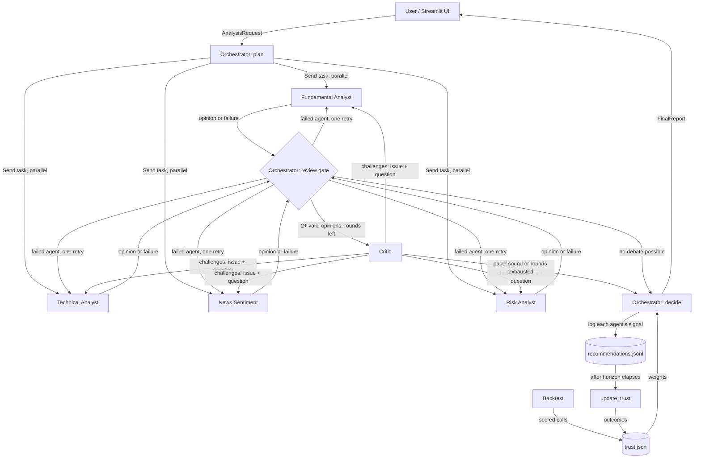

# QuantCrew — Design Document

Team ZEUS. Export this file to PDF for the Design Document artifact. Render the Mermaid diagram at
mermaid.live, export it as PNG, and place the image under section 1 in the PDF.

## 1. Architecture

All agents read and write one shared LangGraph state (the blackboard): opinions, errors, critiques,
revisions and the execution trace. Requests flow down from the Orchestrator; opinions and failures
flow up into the shared state; challenges flow from the Critic back to specific agents; market
outcomes flow back into trust weights, closing the learning loop.

## 2. Agent roles

| Agent | Responsibility | Decides for itself | Output |
|---|---|---|---|
| Orchestrator | Validates input, plans which specialists the question needs and the horizon, retries failed agents, triggers debate, computes the trust-weighted decision, writes the research note | Which agents to activate; horizon if unstated | Plan, FinalReport |
| Fundamental Analyst | Valuation, profitability, leverage, growth trend | Which figures matter for this sector | AgentOpinion |
| Technical Analyst | Trend, momentum, 52-week position | Whether to inspect the raw price path as well as indicators | AgentOpinion |
| News Sentiment | Tone and materiality of recent headlines | Which headlines are material | AgentOpinion |
| Risk Analyst | Volatility, drawdown, VaR/CVaR, beta, relative to the index | Whether risk is unusual for the horizon | AgentOpinion |
| Critic | Fact-checks claims with its own tools; challenges weak, unsupported or contradictory reasoning | Which agents to challenge, and whether revision is needed at all | CriticReview |

Every specialist runs a ReAct loop (`agents/base.py`): the LLM chooses which tools to call, sees the
results including errors, may call more tools, then commits to a structured `AgentOpinion`. If the
model produces an invalid tool call, it is told so and allowed to try again.

**Model choice per agent.** Models are chosen by a profile setting (`QUANTCREW_PROFILE`):

| Profile | Orchestrator + specialists | Critic | Used for |
|---|---|---|---|
| `groq` | gpt-oss-20b (Groq, free tier) | gpt-oss-120b (Groq, free tier) | Development and testing |
| `claude` | Claude Haiku 5.5 | Claude Haiku 5.5 | Backtest, deployed app, demo |

On the free tier, the Critic gets the stronger model because it must verify other agents' numbers,
and Groq's daily limits are per model, so splitting roles also spreads the load. For the backtest and
demo, one fast, low-cost model (about 1 cent per analysis) serves every role: a backtest makes
hundreds of calls, and a paid tier removes the risk of hitting a daily limit during the live demo.
Any role can be overridden individually, e.g. a stronger Critic via `QUANTCREW_CRITIC_MODEL`.

## 3. Orchestration pattern

**Hierarchical orchestrator–worker over a shared blackboard, with a critic-led debate loop.**

- *Orchestrator–worker*: one agent plans and arbitrates; specialists run in parallel (LangGraph `Send`), at most two at a time to respect API rate limits.
- *Blackboard*: all agents write to one typed state (`state.py`) with merge reducers, so parallel writes don't collide and the Critic sees everyone's work.
- *Debate*: the Critic may challenge specific agents. All challenges for one agent are delivered together; the agent re-runs its tools and must revise or defend. One round by default (configurable); the loop ends early when the Critic judges the panel sound.
- *Replanning on failure*: an agent whose tools all fail, or whose LLM call errors, is retried once, then dropped, and the report is marked `degraded`. If an agent fails while revising, its earlier opinion is kept rather than discarded.

**Conflict** is detected when one agent says BUY and another SELL, when the panel is tied with no majority, or when a confident (≥ 0.6) agent disagrees with the majority.

Why not peer-to-peer: with five agents, all-to-all messaging is hard to bound and audit. A central
arbiter keeps the number of LLM calls predictable and makes every decision traceable.

## 4. Technology choices

| Choice | Reason |
|---|---|
| LangGraph | Native parallel fan-out (`Send`), conditional cycles for the debate loop, typed shared state with reducers, streaming updates for the UI |
| Custom ReAct loop instead of a prebuilt agent | Every tool call and thought is captured in the trace, and the team can explain every line |
| `init_chat_model` | One setting switches provider/model per role |
| Groq free tier → Claude Haiku 5.5 | Free Groq models for development; Groq's 200k tokens/day limit could not support the backtest or a reliable demo, so those use Claude Haiku 5.5 |
| Structured output with fallbacks | JSON-schema mode first, then function calling, then plain JSON validated by Pydantic; models differ in which they support reliably |
| yfinance + Google News RSS | Free NSE prices and fundamentals; Yahoo's NSE news is often empty, so Google News (last 7 days, searched by company name) is the fallback |
| Deterministic weighted vote for the final call | The LLM explains the decision but cannot overrule the evidence |
| Streamlit | Fast to deploy; shows each agent's progress live |

## 5. Decision rule

Score = Σ wᵢ·cᵢ·sᵢ / Σ wᵢ·cᵢ, where s ∈ {+1 BUY, 0 HOLD, −1 SELL}, c = agent confidence, w = trust weight.
BUY if score > 0.4, SELL if score < −0.4, otherwise HOLD. A BUY or SELL also requires that more than
50% of weighted conviction agrees with it; otherwise the call becomes HOLD (one confident agent cannot
outvote a holding majority).

Confidence: for BUY/SELL, the share of weighted conviction agreeing with the call. For HOLD,
1 − (largest share of conviction pushing BUY or SELL). "Lean" reports which way the panel tilts.

## 6. Adaptive trust weights

Each agent's own signal is scored once its horizon has elapsed (5/20/60 trading days). Guards against
noisy short-term outcomes:

1. **Dead band** — moves within ±2% are "no move": HOLD is correct; BUY/SELL are not scored either way.
2. **Beta(5,5) prior** — accuracy is the posterior mean, so a short lucky or unlucky streak barely moves it.
3. **Minimum sample size** — weight stays 1.0 until an agent has 15 scored calls.
4. **Rolling window** — only the last 60 scored calls count, so the system adapts to regime changes.
5. **Clamp** — weights stay within [0.5, 1.5]; no agent is silenced or dominant.

Weight = clamp(posterior accuracy / 0.5). Live calls are logged and scored by `scripts/update_trust.py`.
The deployed app's store is seeded from the backtest (`scripts/seed_trust.py`), so Technical and Risk
start with real track records; Fundamental and Sentiment start neutral because they cannot be backtested.

## 7. Evaluation plan

`scripts/backtest.py` walks forward through history, analysing each stock every N trading days with
data up to that date only. The loop is date-major and feeds each call's outcome into trust only once
it is known, so there is no look-ahead. Configurations compared (`scripts/compare_backtests.py`):
full crew, crew without debate, Technical only, Risk only, each against equal-weight buy-and-hold.
Metrics: cumulative return, Sharpe, max drawdown, time in market, directional hit rate, and how
often the debate changed a call.

Limitations: no point-in-time fundamentals or news in yfinance, so those agents are excluded from
backtests; no transaction costs; LLMs may carry knowledge of the backtest period; LLM outputs vary
between runs (temperature is 0, and the debate and weighted vote reduce but don't remove this).

## 8. Robustness

| Situation | Behaviour |
|---|---|
| Symbol not in the Nifty 50 | Rejected by the Orchestrator before any LLM call, with a clear message |
| No price data | Rejected with the data error |
| Empty question | UI asks for one |
| One agent's tools fail | The agent sees the error and may try another tool; if all fail, retried once, then excluded; report marked `degraded` |
| Agent fails while revising | Earlier opinion kept; `revision_failed` recorded in the trace |
| Invalid tool call by the model | Model told the call was invalid and retries |
| API rate limit | Client waits and retries; at most two agents call the API at once |
| Critic fails | Debate skipped, decision proceeds |
| Narrative LLM fails | Fallback note; recommendation unaffected (computed deterministically) |

## 9. Issues found by reviewing execution traces

| Trace showed | Fix |
|---|---|
| Fundamental agent quoting sector averages no tool provides | All agents and the Critic forbidden from using figures from memory |
| Debt-to-equity 9.5 read as 9.5× (yfinance gives a percentage) | Converted to a ratio; units note attached to tool results |
| Revenue in USD next to market cap in INR | Statement currency attached; agents told never to divide one by the other |
| Only the last of several challenges reached an agent | All challenges merged and delivered |
| HOLD-vs-SELL tie not flagged as a conflict | Ties count as conflicts |
| One confident BUY outvoting two HOLDs | Majority-conviction rule |
| HOLD reported with 0% confidence | HOLD confidence and lean defined |
| Rate limit during revision discarded valid opinions | Earlier opinion kept |
